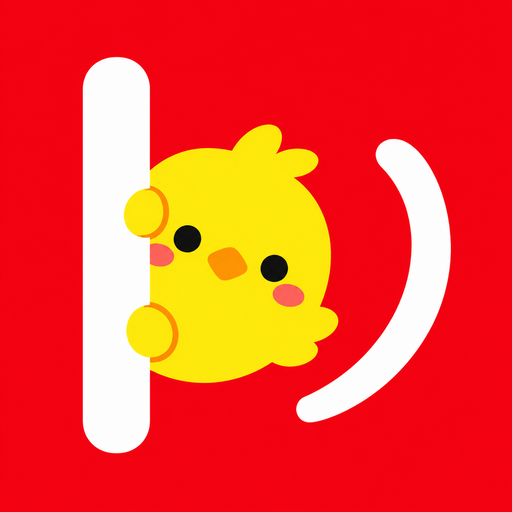
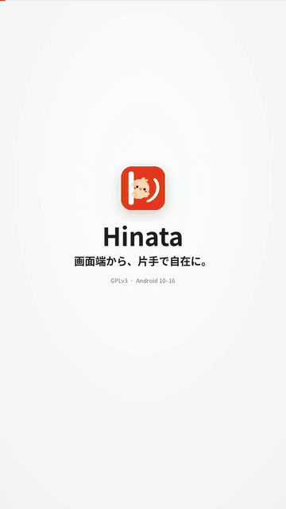

<p align="center">
  
</p>

<p align="center">
  
</p>

<p align="center">
  <strong>愛するランチャーと、もっと自由に。</strong><br>
  サードパーティ製ランチャーでも、純正を超える滑らかなジェスチャー操作を。
</p>

<p align="center">
  <a href="LICENSE"></a>
  
  
  
  
</p>

<p align="center">
  <b>100% Free · Open Source (GPLv3) · Zero Ads · Zero Tracking</b><br>
  Developed by <b>rengix-x</b>
</p>

<p align="center">
  <a href="https://github.com/rengix-x/Hinata/releases/latest"><b>⬇ Download the latest APK / 最新APKをダウンロード</b></a>
  &nbsp;·&nbsp;
  <a href="#setup--初回セットアップ"><b>Setup / 初回セットアップ</b></a>
</p>

---

An ultra-lightweight, privacy-first Android edge gesture, 120fps Prism Glass arc menu, and one-tap on-device screen translator — born on Xiaomi / POCO HyperOS and engineered to work seamlessly across **all Android 10–16 devices**.

Xiaomi / POCO HyperOS の操作性向上から生まれ、すべての Android 10〜16 端末に対応する、超軽量エッジジェスチャー＆ワンタップ画面翻訳アプリです。

---

<p align="center">
  
</p>

## Key Features / 主な機能

- **3-Stage Edge Gestures, Tunable on Both Axes / 横・縦ともに3段階調整できるエッジジェスチャー**
  - Left, right, and bottom edge zones, each with Stage 1 / Stage 2 / Stage 3 actions plus diagonal swipes. Each zone can be switched on/off individually.
  - **Side (horizontal) and bottom (vertical) gestures are tuned independently**: stage distance ratios and hold durations are separate for the side edges and the bottom edge, and the Stage 2 / 3 trigger lines can be placed anywhere up to **85% of the screen**.
  - **Smart auto 2-stage mode**: if Stage 3 is set to "none", the gesture automatically behaves as a clean 2-stage gesture — no empty stage to overshoot.
  - **Nothing fires mid-drag**: actions trigger only on finger release (ACTION_UP), never while you are still pulling.
  - 14dp hysteresis prevents accidental stage jitter; IME avoidance modes and landscape modes keep gestures reliable while typing or gaming.
- **A Full Action Set — 21 Assignable Actions / 割り当てられる全21種のアクション**
  - Navigation & system: Back, Home, Recents, Previous App, Notifications, Quick Settings, Lock Screen, Screenshot, Split Screen, **Flashlight （ライト）**, and **Circle to Search （かこって検索）**.
  - Launch: any app, any app **in a floating window**, the **current app floated**, **URLs**, and **shortcuts — including in-app shortcuts** provided by each app, launched directly in place.
  - Hinata itself: open the Quick Menu, open the Recent Switcher, toggle the translate button, or translate the screen immediately.
- **120fps Prism Glass & Visual Styles / プリズムグラスと表示スタイル**
  - Real-time GPU-accelerated liquid droplet & glass refraction feedback (Android 13+ AGSL `RuntimeShader`, with smooth fallback on Android 10–12), drawn by a pure `android.view.View` + `Canvas` resident overlay with zero heap allocations inside `onDraw()` / `onTouchEvent()`. Refraction strength is adjustable from 20% to 150%.
  - The glass tint follows your wallpaper smoothly: a trimmed-average brightness sampling with temporal smoothing means the droplet never flickers or hard-flips between light and dark backgrounds.
  - Droplet geometry is tunable too: height 18–56dp, skirt width 72–200dp.
  - Glass themes: **Prism Glass / Light / Dark / Dynamic (Material You)**, plus feedback shapes **しずく (droplet) / シンプル (minimal) / 非表示 (hidden)** and 4-step haptics.
  - **Custom Media feedback**: use your own **transparent GIF / animated WebP / PNG / JPEG** as the gesture feedback — on its own, or framed inside the glass droplet （水滴＋画像）.
- **One-Stroke Rotating Arc Quick Menu / ワンストローク回転アークメニュー（最大16スロット）**
  - **3–16 slots** holding apps, floating-window apps, shortcuts (including in-app shortcuts), URLs, and system actions such as the flashlight — all launched in a single continuous swipe without lifting your finger.
  - With **7 or more slots**, the fan becomes a **120fps rotary wheel**: tilt your finger to the fan's edge and hold ~110ms to rotate through the rest, with a fine click haptic per slot.
  - A **sticky tap-to-select mode** keeps the menu open after you lift your finger, so you can tap or scroll through slots at your own pace. Menu size (84–156dp) and background dim (0–40%) are adjustable.
  - Four trigger methods that never fight your other gestures: a dedicated edge sub-zone, a stationary edge hold, pull-and-return, or a classic gesture-slot assignment.
- **Genuine Floating Windows / 本物の小窓**
  - Launch a chosen app into the genuine, shrink-scaled floating window, or float the app currently in front of you.
  - Without Shizuku (HyperOS), a transparent proxy activity floats the current app directly — no Control Center needed; the Control Center tile macro remains as a fallback.
- **Circle to Search / かこって検索**
  - Native Google Circle to Search, triggered from a gesture or by long-pressing the bottom bar (300ms).
  - On CN ROMs where the OEM resets Google Assistant, Shizuku auto-repair restores it; an external MiCTS fallback is also supported.
- **Recent App History Switcher / アプリ履歴スイッチャー**
  - Instant visual app switcher backed by a permission-free accessibility ring buffer of your latest 8 apps, with optional `PACKAGE_USAGE_STATS` backfill covering the last 24 hours — so history is ready even right after a reboot.
- **One-Tap Screen Translate / ワンタップ画面翻訳**
  - Compact edge-docked `文A` floating button (`46dp × 68dp`) with zero background polling, zero battery drain, and zero flicker. One tap translates; one more tap clears it.
  - A 5-button mini toolbar adds: force re-translate, **press-and-hold "peek original"**, one-tap language swap, engine switch (online/offline), and close.
  - **Offline by default** via Google ML Kit (OCR for 42 source languages across Latin, Japanese, Chinese, Korean and Devanagari scripts + 59-language on-device translation), plus an **opt-in High-Quality Online Engine** with explicit first-time consent.
  - Translations are painted over the original text in its own colors and fitted font size (inpainting-style), in two render styles: 背景なじみ（置換）and 半透明カード. Scrolling or switching apps auto-clears the overlay so translated text never lingers out of place.
- **Beginner A/B Auto-Tuning (Beta) / 初心者A/B自動チューニング（Beta）**
  - A setup wizard that measures your real thumb swipes (thumb position and swipe distance telemetry) and A/B preference answers, then generates a configuration fitted to your hand.
- **Six-Layer Safety & Emergency Recovery / 落ちない・詰まない6重セーフティ**
  - Hinata never leaves you stranded without navigation: a silent keep-alive notification with one-tap "reload" and "restore navigation" buttons, a Quick Settings "Hinata Recovery" tile, and app-icon long-press shortcuts for emergency restore.
  - If the app is ever killed while the navigation bar is hidden, a Shizuku **dead man's switch** (binder-death detection in the privileged process) restores the 3-button navigation and OS gestures immediately — and if the OS silently turns the Accessibility service off, an emergency notification offers one-tap recovery.
  - All activities are excluded from Recents, so a "close all" swipe can never take Hinata down with them; and if Accessibility is off, the settings UI hard-locks to just the recovery actions until it is back on.
- **Optional Shizuku Integration / 任意の Shizuku 連携（Root不要）**
  - Hide the system navigation bar — with an auto-guard that re-hides it after unlocks and OEM resets — suppress conflicting OS edge-back gestures, and launch genuine floating mini-windows.
  - Safety nets included: a Quick Settings recovery tile and emergency notification actions that restore the 3-button navigation bar at any time.
- **5-OEM Auto-Adaptation & 4 Languages / 5大OEM自動適応＆4言語対応**
  - Automatic compatibility tuning for **HyperOS (Xiaomi/POCO)**, **ColorOS / OxygenOS / realme UI**, **OriginOS (vivo/iQOO)**, **One UI (Samsung)**, and **AOSP / Pixel / Xperia / Nothing / Motorola**, with a per-app exclusion list for apps that should never trigger gestures.
  - Full UI localization in **English**, **日本語**, **简体中文**, and **हिन्दी**.

---

## Honest Privacy Policy / 誠実なプライバシーポリシー

- **Zero Telemetry / Zero Analytics / Zero Ads**: Hinata itself contains no analytics SDKs, crash trackers, or advertising libraries, and disables Android backup (`android:allowBackup="false"`) and cleartext HTTP traffic (`cleartextTrafficPermitted="false"`).
- **Default Local Operation**: During normal gesture navigation and offline screen translation, Hinata never uploads screenshots, images, or gesture history.
- **Two Explicit HTTPS Network Uses Only**:
  1. **Google ML Kit Offline Models**: Downloading and managing on-device ML Kit offline translation language packs (~30 MB, Wi-Fi-only toggle enabled by default), including standard HTTPS model delivery and management requests performed internally by the Google ML Kit SDK.
  2. **Opt-in Online High-Quality Translation**: Disabled by default. Only enabled after explicit user consent in Screen Translate Settings. Even when enabled, **only extracted plain text is sent over HTTPS — screenshots and images are never transmitted**, and password fields / `FLAG_SECURE` screens are automatically excluded. You can switch back to 100% offline mode at any time.
- **Verify Your Download / ダウンロードの検証**: SHA-256 checksums for every APK are published in `SHA256SUMS.txt` attached to each Release. Signing certificate (SHA-256): `0A:CB:E0:F2:5B:2E:8C:1E:F0:82:91:9C:87:30:65:3B:06:C7:6B:D1:85:98:BB:61:A2:A4:01:28:4E:F7:F6:D3` (see [SECURITY.md](SECURITY.md)).

---

## Architecture & Developer Guide / アーキテクチャ設計

Hinata enforces strict **dual-process isolation** to keep background RAM usage minimal (~10–15 MB) while offering a rich Material 3 settings experience:

| Process | Entry Point | Tech Stack | Purpose |
| --- | --- | --- | --- |
| Default (`io.github.rengixx.hinata`) | `EdgeAccessibilityService`, `EdgeConfigProvider`, `FloatingProxyActivity` | Pure Kotlin + Android `View` / `Canvas` + AGSL (`RuntimeShader`) | Always-on 120Hz touch interception, Prism Glass overlays, Arc Menu, One-Tap Screen Translate (**ZERO Jetpack Compose imports**) |
| `:settings` (`io.github.rengixx.hinata:settings`) | `SettingsActivity` | Jetpack Compose + Material 3 + `HinataIcons` | Onboarding, gesture tuning, diagnostics, translate settings — completely reclaimed by Android when closed |

### Directory Map

```text
app/src/main/java/
├── com/edgeflow/
│   ├── data/                # EdgeConfig, ConfigStore, EdgeConfigProvider (IPC), OEM detection, MlKitSafeInit
│   ├── service/             # Resident process ONLY (NO Compose): EdgeAccessibilityService, EdgeOverlayController,
│   │   │                    # ActionExecutor, LiquidGlassShader, FloatingWindowLauncher, ControlCenterFloatingMacro
│   │   ├── shizuku/         # ShizukuShellExecutor, NavBarUserService (AIDL)
│   │   └── translate/       # One-tap LiveScreenTranslateController, TranslateFloatingControlView,
│   │                        # StructuredNodeTextExtractor, WindowCleanCapturer, OnDeviceTranslationPipeline
│   └── settings/            # Isolated :settings Compose UI (Onboarding, Zones, Arc, Actions, Blacklist, Guide, Translate)
└── com/example/ui/
    ├── icons/HinataIcons.kt # Self-contained Material Rounded 24x24 vector paths (zero material-icons-extended bloat)
    └── theme/               # Material 3 Dynamic Color, OS-native SansSerif Typography & Tabular Numerics (`tnum`)
```

> Note: Internal Kotlin package names (`com.edgeflow.*` and `com.example.*`) are intentionally preserved for backward compatibility with existing configuration storage (`edgeflow_config.cfg`), AndroidManifest components, and unit tests, while the public `applicationId` is `io.github.rengixx.hinata`.

---

## Setup / 初回セットアップ

1. Install the APK and follow the in-app onboarding.
2. **Android 13+: allow restricted settings first.** Because Hinata is sideloaded, Android may block turning on the Accessibility service until you open **App info → ⋮ (top-right) → "Allow restricted settings"**. The onboarding shows this step before the Accessibility switch.
3. **If you have hidden the 3-button navigation bar** (for example with Shizuku), restore the buttons before setup. Without buttons or gestures you cannot move through the Settings screens — and because the hidden state is a system setting, it stays hidden even after reinstalling the app.

1. APKをインストールし、アプリ内のオンボーディングに従ってください。
2. **Android 13以降：先に「制限付き設定を許可」が必要です。** サイドロードしたアプリは、**アプリ情報 → 右上の「⋮」→「制限付き設定を許可」** を済ませないとユーザー補助をオンにできないことがあります。オンボーディングでも同じ手順を案内します。
3. **3ボタンナビゲーションを非表示にしている場合**（Shizukuで消した場合など）は、セットアップの前にボタン表示に戻してください。ボタンもジェスチャーもないと設定画面を移動できません。この非表示状態は端末側のシステム設定のため、アプリを再インストールしても消えたままになります。

---

## Building from Source / ビルド手順

Requirements: **JDK 17+**, **Android SDK 36** (`compileSdk = 36`, `minSdk = 29`).

```bash
# 1. Run all unit tests
./gradlew testDebugUnitTest

# 2. Build a single optimized Release APK (arm64-v8a + armeabi-v7a, R8 Full Mode)
./gradlew assembleRelease

# 3. Build ABI-split Release APKs (arm64-v8a, armeabi-v7a, and universal)
./gradlew assembleRelease -PsplitAbi=true
```

For production release signing (local `keystore.properties` or GitHub Actions Secrets), see **[docs/KEYSTORE_GUIDE.md](docs/KEYSTORE_GUIDE.md)**.

---

## Contributing, License & Credits

- **Contributing Guide**: [CONTRIBUTING.md](CONTRIBUTING.md)
- **Keystore & Release Signing Guide**: [docs/KEYSTORE_GUIDE.md](docs/KEYSTORE_GUIDE.md)
- **Release Notes (v1.0.0)**: [RELEASE_NOTES_v1.0.0.md](RELEASE_NOTES_v1.0.0.md)
- **Open-Source Credits & Disclaimers**: [CREDITS.md](CREDITS.md)
- **License**: [GNU General Public License v3.0 (GPLv3)](LICENSE) (`Copyright (C) 2026 rengix-x` — Open Source (GPLv3))
